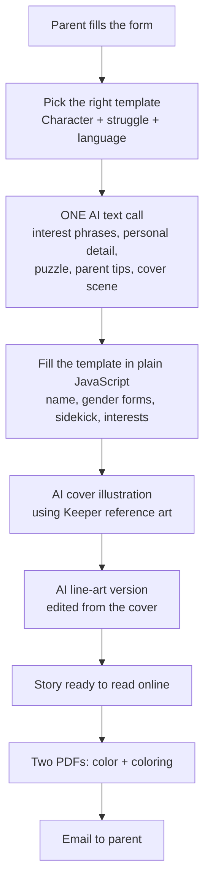

# GTales 📚✨
 
**Personalized interactive storybooks where the child is the hero, and the Keepers need their help.**
 
🌐 [gtales.kids](https://gtales.kids) · 🟢 Live since October 2026 · 📖 400+ stories delivered · 🖨️ 140 printed · 🇬🇧 English + 🇪🇬 Egyptian + 📜 Literary Arabic
 


---
 
## 💭 Why I built it
 
When I was little, my dad taught me patience with a story about a girl named Malak who kept nagging. Plot twist: Malak was me.
 
Years later, I told my little brother bedtime stories with maths questions hidden inside. His review: *"This is too easy. Give me something harder."*
 
Stories teach what lectures can't. GTales makes that personal for every child.
 
 
## ✨ What a parent gets
 
- 🧒 A story starring their child: name, interests, appearance, even a sidekick (a friend, sibling, or pet)
- 🧩 Puzzles inside the story: mazes, word searches, connect-the-dots, hidden objects, riddles, maths, choose-your-path, matched to the child's age (3–5, 6–8, 9–11)
- 🎨 A custom illustrated cover, plus a **line-art version to color in**
- 🖨️ Two print-ready PDFs (color + coloring book) by email, or a printed book delivered home
- 👨‍👩‍👧 Tips for parents on handling the same feeling at home
## ⚙️ How a story is made
 

 
## 🧠 The engineering decisions I'm proudest of
 
**1. AI only where it's needed.**
The story structure comes from hand-written templates, so the emotional lesson is always correct and age-appropriate. The AI only fills in the personal parts. That means **1 text call + 2 image calls per story, about $0.07 each.**
 
**2. Real Arabic, not translated English.**
Arabic changes verbs and adjectives for boys and girls. My templates use gender forks like `{{he|she}}` and `{{راح|راحت}}`, so every sentence is grammatically right for that child, in both languages. The AI even returns interest phrases in the exact grammatical form each sentence needs.
 
**3. The same puzzle online and on paper.**
Mazes, word searches, and hidden-object puzzles are generated by code and **seeded by the story's ID**, so the puzzle a child plays online is identical to the one in their printed book.
 
**4. Characters that stay consistent.**
Every Keeper has reference art that's sent to the image model with each prompt, so Blaze always looks like Blaze. The coloring page is made by editing the cover, so both images match.
 
**5. Arabic-safe PDFs.**
PDFs are rendered with headless Chrome, so right-to-left Arabic text prints correctly.
 
**6. Honest AI.**
If a parent's situation doesn't match any template, the AI writes the whole story, and the parent is told **twice** that it's AI-written.
 
## 🧰 Tech stack
 
| Layer | Tool |
|---|---|
| Web app | Next.js 16 (App Router) + Tailwind v4 |
| Hosting | Cloudflare Workers (via OpenNext) |
| AI text + images | Google Gemini |
| Database + file storage | Supabase (Postgres + Storage), Frankfurt region (closest to Egypt) |
| Email | Resend |
| PDFs | Headless Chrome |
 
## 🧪 Run it locally (no API keys needed)
 
```bash
npm install
cp .env.example .env.local   # leave keys empty for mock mode
npm run dev                  # http://localhost:3000
```
 
**Mock mode:** stories save to `.data/`, emails land in `.data/outbox/`, AI output is pre-written, and illustrations are placeholders. Anyone can run the whole app without spending a cent.
 
## 🗂️ Admin dashboard
 
- `/admin` · every story: Keeper, struggle, language, status, and errors
- `/admin/orders` · printed-book orders with delivery details and a "Mark as shipped" toggle
## 🙋 Who did what
 
I designed and built GTales: the templates system, story pipeline, puzzle
 generators, app, and PDFs. My parents helped me get it in front of families.
 
## 💛 Favorite feedback so far
 
A parent told me GTales helped their child make friends and step outside their comfort zone. That's the whole point.
 
## 🔮 Next
 
Full on interactive personalized story games --> Gamilfied Tales
